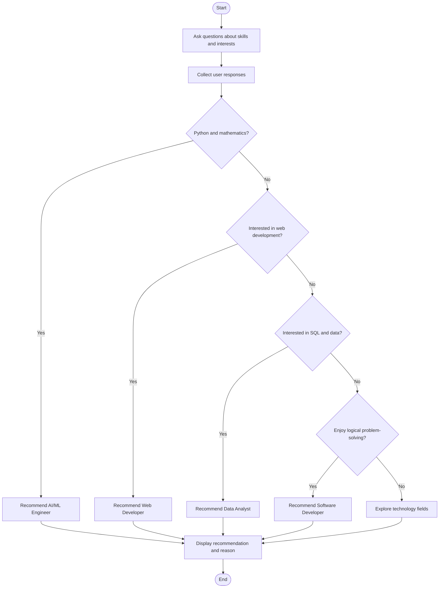

# 🎓 Rule-Based Expert System — Student Career Recommendation

A beginner-friendly Artificial Intelligence project built using Python that recommends a suitable career path based on a student's interests and skills. It uses predefined **IF–THEN rules** and rule-based reasoning to generate recommendations.

## 📌 Project Overview

Choosing a career can be difficult for students who are unsure which technology field matches their interests. This project demonstrates how an expert system can use user responses and predefined rules to provide a basic career recommendation.

The system asks questions about programming, mathematics, web development, SQL, and logical problem-solving. Based on the answers, it recommends a suitable career option.

## ✨ Features

- Interactive question-and-answer interface
- Rule-based decision-making using `if-elif-else`
- Career recommendations based on user responses
- Explanation of why a career was recommended
- Beginner-friendly Python implementation
- No external libraries required

## 🛠️ Technologies Used

- **Programming Language:** Python 3
- **AI Concept:** Rule-Based Expert System
- **Decision Logic:** IF–THEN rules
- **Interface:** Command-line interface (CLI)

## 🧠 AI Concepts Used

### 1. Knowledge Base
Contains predefined rules that connect students' interests with career recommendations.

### 2. Inference Engine
Evaluates the user's answers and applies the rules to select a recommendation.

### 3. User Interface
Collects answers through the terminal and displays the result.

### 4. Rule-Based Reasoning
The system uses conditions to make decisions instead of learning from a training dataset.

## ⚙️ How It Works

1. The system asks the user questions about their skills and interests.
2. The user responds with `yes` or `no`.
3. The inference engine checks the predefined rules.
4. The first matching rule determines the recommendation.
5. The system displays the recommended career and its reason.

## 🔄 Flowchart



## 📂 Project Structure

```text
Rule-Based-Expert-System/
│
├── main.py
└── README.md
```

## 🚀 Installation and Execution

### Prerequisites
Install Python 3 on your system.

### Step 1: Clone the Repository

```bash
git clone https://github.com/Prachipandey28/Rule-Based-Expert-System.git
```

### Step 2: Open the Project Folder

```bash
cd Rule-Based-Expert-System
```

### Step 3: Run the Program

```bash
python main.py
```

If your system uses `python3`, run `python3 main.py` instead.

## 💻 Sample Output

```text
=============================================
 STUDENT CAREER EXPERT SYSTEM
=============================================

Answer using yes or no.

Do you enjoy Python programming? yes
Do you enjoy mathematics? yes
Do you enjoy HTML, CSS, and JavaScript? no
Do you enjoy SQL and analyzing data? yes
Do you enjoy solving logical problems? yes

=============================================
 EXPERT SYSTEM RESULT
=============================================
Recommended career: AI / Machine Learning Engineer
Reason: You enjoy Python and mathematics.
=============================================
```

## 🎯 Example Rules

| Condition | Recommendation |
|---|---|
| Python = Yes and Mathematics = Yes | AI / Machine Learning Engineer |
| Web Development = Yes | Web Developer |
| SQL and Data Analysis = Yes | Data Analyst |
| Logical Problem-Solving = Yes | Software Developer |
| No rules match | Explore Technology Fields |

**Note:** The program uses the first matching rule. These recommendations are illustrative and should not be treated as professional career assessments.

## 🔮 Future Improvements

- Add a graphical user interface using Tkinter or Streamlit.
- Use a scoring system to evaluate all answers.
- Recommend multiple careers with explanations.
- Store user responses and recommendation history.
- Add more career paths and customizable rules.

## 📚 Learning Outcomes

By completing this project, you will understand:

- The fundamentals of expert systems in Artificial Intelligence
- Knowledge bases and inference engines
- IF–THEN rules and conditional statements in Python
- How rule-based reasoning supports simple decision-making

## 👩‍💻 Author

**Prachi Pandey**

B.Tech — Artificial Intelligence and Data Science

GitHub: [@Prachipandey28](https://github.com/Prachipandey28)

---

⭐ If you find this project useful, consider giving the repository a star!
